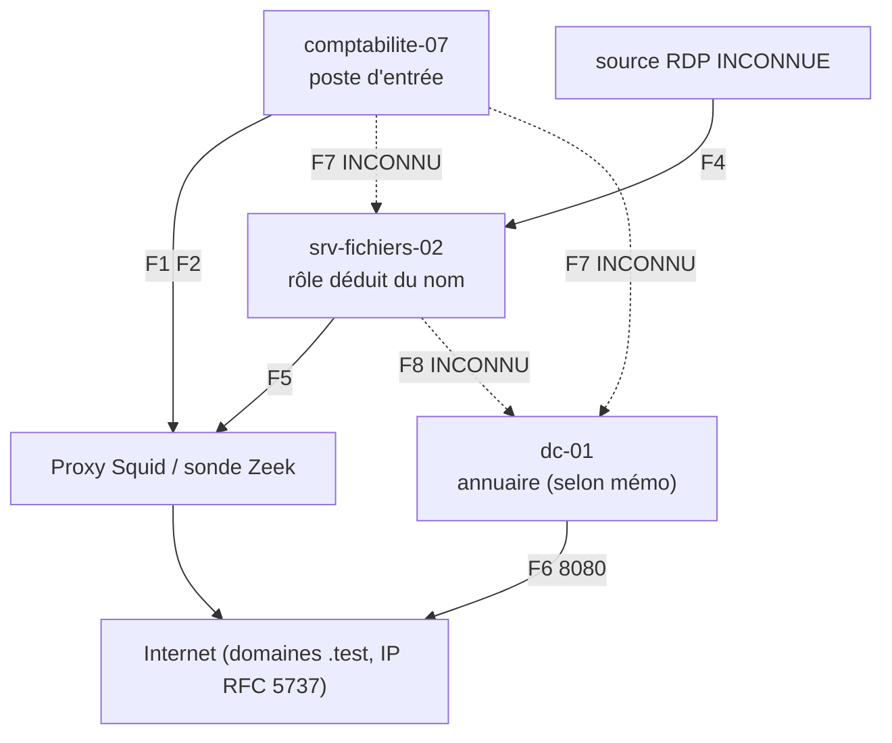

# Cartographie du SI connu (Helios Energy, fictif)

Date : 2026-10-06. **Cartographie construite uniquement avec ce que le dossier révèle.** Les inconnues sont visibles. Elle complète le graphe CTI (`06-STIX-Graphe/Graphe-CTI.png`), qui ne la remplace pas.

## 1. Méthode d'analyse de risques

Approche **inspirée d'EBIOS Risk Manager** (socle de sécurité et valeurs métier, sources de risque, scénarios), **simplifiée** : atelier 1 (périmètre et actifs) et trame d'atelier 3 (scénarios stratégiques) seulement. Ce n'est **pas** une analyse EBIOS RM complète : pas d'ateliers avec les métiers, pas de gravité validée, pas d'évaluation de vraisemblance chiffrée. Choix de méthode retenu (Q19) : EBIOS RM simplifiée.

## 2. Actifs connus

| Actif | Nature | Rôle (source) | Zone | Éléments observés | Inconnu |
|---|---|---|---|---|---|
| comptabilite-07 | Poste utilisateur | Poste du service comptabilité, poste d'entrée (mémo) | réseau interne 10.20.0.0/16 (présumé) | Exécution PowerShell, tâche planifiée, balise, effacement du journal Security | Adresse IP, utilisateur, logiciels |
| srv-fichiers-02 | Serveur | Nom évoquant un serveur de fichiers (rôle non documenté) | interne | RDP par svc-backup-temp, thread distant dans explorer.exe, requête de repli | Volumétrie et nature des données hébergées |
| dc-01 | Serveur | Contrôleur de domaine (mémo, nom) | interne | Accès LSASS, création et suppression d'un compte, sortie de 2,47 Go | Contenu sorti ; compromission réelle de l'annuaire non démontrée |
| poste-rh-11, poste-dsi-03 | Postes | Apparaissent dans le bruit du journal | interne | Aucun événement hostile | Rôle |
| Proxy (Squid), sonde Zeek, SIEM | Supervision | Sources des lignes de journal | n/a | Fonctionnels le 2 mars (au moins) | Couverture réelle, rétention |
| Comptes m.durand, s.leroy, j.moreau, a.petit, admin.sys | Identités | Sessions du bruit | n/a | Aucun lien avec l'attaque démontré | Privilèges |
| Compte svc-backup-temp | Identité | Compte « temporaire » | domaine (très probable) | Utilisé le 4 mars, créé le 5 mars (contradiction I-03) | Existence antérieure |
| Messagerie, passerelle de courriel | Service | Origine supposée du classeur | inconnue | Aucun journal | Tout |

## 3. Flux connus

| Flux | De | Vers | Preuve | Statut |
|---|---|---|---|---|
| F1 téléchargement HTTPS | comptabilite-07 | `cdn-svc-update.test` via proxy | journal l.2 | OBSERVÉ |
| F2 connexion en 443 | comptabilite-07 | 198.51.100.24 | journal l.4 | OBSERVÉ |
| F3 balayage 445/3389 | source 198.51.100.55 | 10.20.0.0/16 | journal l.5 | OBSERVÉ, source de nature inconnue |
| F4 RDP | source inconnue | srv-fichiers-02 | journal l.6 | OBSERVÉ, source INCONNUE |
| F5 requête de repli | srv-fichiers-02 | `static-assets-cache.test` | journal l.11 | OBSERVÉ |
| F6 sortie en clair | dc-01 | 203.0.113.28:8080 | journal l.10 | OBSERVÉ |
| F7 mouvement latéral de comptabilite-07 vers srv-fichiers-02 et dc-01 | | | aucun | **INCONNU** (mécanisme absent) |
| F8 données des serveurs de fichiers vers dc-01 | | | aucun | **INCONNU** (HYP-007) |

## 4. Dépendances

dc-01 (annuaire) conditionne l'authentification de tous les hôtes ; srv-fichiers-02 dépend de l'annuaire et du réseau ; comptabilite-07 dépend du proxy pour l'accès externe. Les dépendances métier (processus de l'opérateur d'énergie, systèmes industriels) ne sont **pas** documentées : aucun système industriel n'est cité comme touché.

## 5. Inconnues majeures

Plan d'adressage et segmentation réels ; chemin d'accès initial (courriel absent) ; chemin de mouvement latéral ; contenu exfiltré ; existence et rôle de systèmes industriels ; sauvegardes ; journaux conservés ; alignement des horloges.
