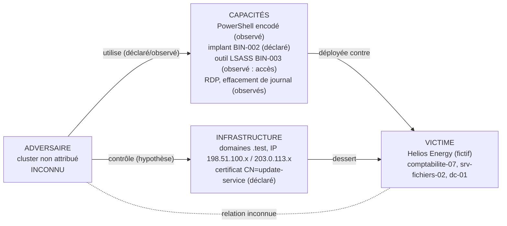

# Diamond Model : intrusion INC-2026-0302

Cluster d'activité **non attribué**. Chaque sommet porte son statut : OBSERVÉ / CORROBORÉ / DÉCLARÉ / HYPOTHÈSE / INCONNU.

## 1. Sommets

| Sommet | Contenu | Statut | Preuve | Limite |
|---|---|---|---|---|
| Adversaire | Opérateur du cluster ; identité, motivation, organisation | **INCONNU** | aucune | L'indication du LISEZ-MOI n'est pas une preuve |
| Capacités | Chaîne PowerShell masquée ; téléchargement d'un exécutable ; tâche planifiée ; accès mémoire LSASS ; RDP ; thread distant dans explorer.exe ; création et suppression de compte ; sortie de 2,47 Go ; effacement du journal Security | OBSERVÉ pour les actions, DÉCLARÉ pour les outils (BIN-001 à 003) | journal l.1 à 12 ; fiches | Aucun échantillon ; les outils ne sont pas rapprochés d'une famille |
| Infrastructure | Domaines `cdn-svc-update.test` (observé), `static-assets-cache.test` (observé), `api-telemetry-eu.test`, `mail-secure-login.test`, `helios-energy-portal.test`, `update-win-msft.test` (déclarés) ; IP 198.51.100.24 et 203.0.113.28 (observées) ; IP restantes déclarées | mixte | IOC-013, 016, 020, 024 | Plages de documentation : aucune résolution possible ; rôles (C2 principal, repli) non démontrés |
| Victime | Helios Energy (fictif) ; hôtes comptabilite-07, srv-fichiers-02, dc-01 | OBSERVÉ pour les hôtes | journal | Statut d'opérateur d'importance vitale : énoncé du sujet, pas un artefact |

## 2. Relations du losange

| Relation | Connu | Inconnu |
|---|---|---|
| Adversaire vers capacités | l'enchaînement observé exige un opérateur humain ou un automate (RDP, création de compte) | qui, combien, depuis où |
| Adversaire vers infrastructure | aucune preuve d'enregistrement ni d'hébergement | propriétaire des domaines et IP |
| Capacités vers victime | actions observées sur trois hôtes | accès initial réel (courriel non fourni), mouvement latéral de comptabilite-07 vers les autres hôtes |
| Infrastructure vers victime | un téléchargement, une connexion, une sortie, une requête de repli | lien domaine vers IP (déclaré seulement) |
| Adversaire vers victime | aucune relation sociopolitique établie | motivation, ciblage |

## 3. Méta-caractéristiques

Phase : intrusion, collecte d'identifiants, sortie de données et effacement de traces, du 2 au 7 mars (bornes d'observation). Résultat observé : exécution de code, accès à LSASS, création de compte, volume sortant. Méthodologie : enchaînement classique (hameçonnage, PowerShell, persistance, identifiants, exfiltration) partagé par de nombreux acteurs. Ressources : non mesurables.

## 4. Pivots exploitables (sans les surinterpréter)

IOC-016 « même certificat » et IOC-027 « passive DNS partagé » seraient des pivots d'infrastructure : **non utilisables**, les artefacts de support (certificat, passive DNS) ne sont pas fournis. IOC-028 et IOC-035 sont des pivots vers des sources externes absentes.
