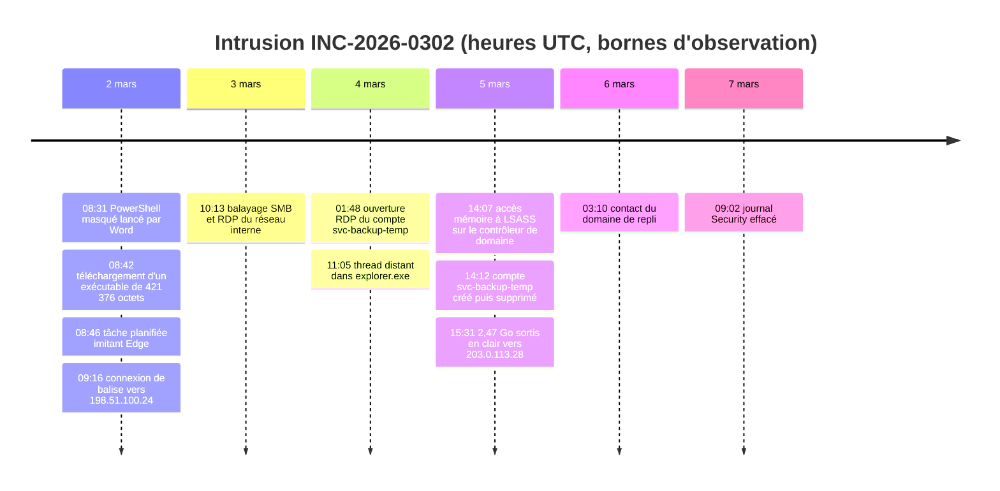

# Chronologie de l'incident INC-2026-0302

Générée par `04-Analyse/generer-timeline.py` depuis [Chronologie.csv](Chronologie.csv) (34 événements), [Matrice-analyse-alertes.csv](Matrice-analyse-alertes.csv) et [Matrice-ATTACK.csv](Matrice-ATTACK.csv). Rien n'est ressaisi à la main. **Les dates sont des bornes d'observation (du 2 au 7 mars 2026), pas le début ni la fin certains de l'intrusion.** Les « premières vues » des IoC sont des dates de découverte, pas des heures d'événement.

## 1. Frise

## 2. Les 12 événements observés

Chaque ligne s'appuie sur une alerte SIEM retrouvée dans le journal brut. La technique ATT&CK est rattachée à l'alerte (statut observée ou probable, voir [Matrice ATT&CK](Matrice-ATTACK.csv)). L'ordre est chronologique ; les numéros d'alerte ne le sont pas.

| # | Date et heure (UTC) | Phase | Hôte | Ce qui est observé | Technique ATT&CK | Confiance | Preuve |
|---|---|---|---|---|---|---|---|
| 1 | 02/03 08:31 | Exécution | `comptabilite-07` | PowerShell masqué lancé par Word | T1059.001 PowerShell (observée) ; T1564.003 Hidden Window (observée) | élevée | [ALERT-001](../04-Analyse/Matrice-analyse-alertes.csv) |
| 2 | 02/03 08:42 | Chargement d'outil | `comptabilite-07` | Téléchargement d'un exécutable de 421 376 octets | T1105 Ingress Tool Transfer (observée) | élevée | [ALERT-002](../04-Analyse/Matrice-analyse-alertes.csv) |
| 3 | 02/03 08:46 | Persistance | `comptabilite-07` | Tâche planifiée imitant Edge | T1053.005 Scheduled Task (observée) | moyenne | [ALERT-003](../04-Analyse/Matrice-analyse-alertes.csv) |
| 4 | 02/03 09:16 | Commande et contrôle | `comptabilite-07` | Connexion de balise vers 198.51.100.24 | T1071.001 Web Protocols (probable) | moyenne | [ALERT-004](../04-Analyse/Matrice-analyse-alertes.csv) |
| 5 | 03/03 10:13 | Découverte | `comptabilite-07` | Balayage SMB et RDP du réseau interne | T1046 Network Service Discovery (observée) | élevée | [ALERT-006](../04-Analyse/Matrice-analyse-alertes.csv) |
| 6 | 04/03 01:48 | Mouvement latéral | `srv-fichiers-02` | Ouverture RDP du compte svc-backup-temp | T1021.001 Remote Desktop Protocol (observée) ; T1078 Valid Accounts (probable) | moyenne | [ALERT-007](../04-Analyse/Matrice-analyse-alertes.csv) |
| 7 | 04/03 11:05 | Injection de code | `srv-fichiers-02` | Thread distant dans explorer.exe | T1055 Process Injection (observée) | élevée | [ALERT-008](../04-Analyse/Matrice-analyse-alertes.csv) |
| 8 | 05/03 14:07 | Accès aux identifiants | `dc-01` | Accès mémoire à LSASS sur le contrôleur de domaine | T1003.001 LSASS Memory (probable) | élevée | [ALERT-005](../04-Analyse/Matrice-analyse-alertes.csv) |
| 9 | 05/03 14:12 | Persistance (compte) | `dc-01` | Compte svc-backup-temp créé puis supprimé | T1136.002 Domain Account (probable) | moyenne | [ALERT-009](../04-Analyse/Matrice-analyse-alertes.csv) |
| 10 | 05/03 15:31 | Exfiltration | `dc-01` | 2,47 Go sortis en clair vers 203.0.113.28 | T1048.003 Exfiltration Over Unencrypted Non-C2 Protocol (probable) | moyenne | [ALERT-010](../04-Analyse/Matrice-analyse-alertes.csv) |
| 11 | 06/03 03:10 | Commande et contrôle (repli) | `srv-fichiers-02` | Contact du domaine de repli | T1008 Fallback Channels (probable) ; T1071.001 Web Protocols (probable) | faible à moyenne | [ALERT-011](../04-Analyse/Matrice-analyse-alertes.csv) |
| 12 | 07/03 09:02 | Effacement des traces | `comptabilite-07` | Journal Security effacé | T1685.005 Clear Windows Event Logs (observée) | élevée | [ALERT-012](../04-Analyse/Matrice-analyse-alertes.csv) |

Le détail de chaque événement (observation brute, interprétation, limites) est dans la ligne correspondante de [Chronologie.csv](Chronologie.csv) : [CHR-004](Chronologie.csv), [CHR-007](Chronologie.csv), [CHR-009](Chronologie.csv), [CHR-010](Chronologie.csv), [CHR-016](Chronologie.csv), [CHR-018](Chronologie.csv), [CHR-020](Chronologie.csv), [CHR-023](Chronologie.csv), [CHR-025](Chronologie.csv), [CHR-030](Chronologie.csv), [CHR-031](Chronologie.csv), [CHR-034](Chronologie.csv) pour les 12 lignes ci-dessus.

## 3. Anomalies de la chronologie (signalées, jamais corrigées)

| Repère | Constat |
|---|---|
| CHR-012 (02/03 10:30) | Date d'en-tête du mémo « initial » : Date NON FIABLE : le mémo décrit des faits du 5 mars (I-02) |
| CHR-018 (04/03 01:48) | 4624 type 10 pour svc-backup-temp sur srv-fichiers-02 : RDP par un compte créé 36 h plus tard (I-03) : fiabilité CONTESTEE |
| CHR-028 (05/03 14:55) | Suppression de svc-backup-temp selon le détail ; 14:57 selon le calcul « 45m later » depuis 14:12 : Compte éphémère : durée ~45 min |
| ALERT-005 | l'alerte 5 (accès LSASS, 05/03) porte un numéro plus bas que les alertes du 3 et 4 mars : la numérotation du SIEM n'est pas chronologique |

## 4. Les 20 autres repères de Chronologie.csv

Ce sont des **premières vues d'IoC déclarées** par le SOC (confiance faible) et des points de contexte : ils situent l'infrastructure mais ne sont pas des événements observés dans un journal.

| Repère | Date et heure (UTC) | Constat | Statut | Confiance |
|---|---|---|---|---|
| CHR-001 | 02/03 06:40 | Domaine helios-energy-portal.test, première vue (IOC-017) | DECLARE | faible |
| CHR-002 | 02/03 07:58 | Page d'hameçonnage mail-secure-login.test et son IP, première vue (IOC-015, IOC-023) | DECLARE | faible |
| CHR-003 | 02/03 08:30 | Première apparition de BIN-001 (facture_mars_2026.xlsm), poste comptabilite-07 (IOC-040) | DECLARE | moyenne |
| CHR-005 | 02/03 08:32 | Charge PowerShell déchiffrée, sha256 (IOC-010) | DECLARE | faible |
| CHR-006 | 02/03 08:41 | Première vue de BIN-002 et du domaine de téléchargement (IOC-004, IOC-013) | DECLARE | moyenne |
| CHR-008 | 02/03 08:44 | Clé de registre Run\WinTelemetry, première vue (IOC-038) | DECLARE | faible |
| CHR-011 | 02/03 09:20 | Serveur de commande principal 203.0.113.14 et certificat CN=update-service, première vue | DECLARE | faible |
| CHR-013 | 03/03 02:00 | IP de commande de repli 203.0.113.15, première vue | DECLARE | faible |
| CHR-014 | 03/03 03:22 | static-assets-cache.test (même certificat) et 198.51.100.61 (passive DNS partagé avec D-04), première vue | DECLARE | faible |
| CHR-015 | 03/03 10:12 | 198.51.100.55, première vue | DECLARE | faible |
| CHR-017 | 04/03 01:47 | 203.0.113.44, RDP entrant, première vue (IOC-026) | DECLARE | faible |
| CHR-019 | 04/03 11:04 | update-win-msft.test, première vue (IOC-018) | DECLARE | faible |
| CHR-021 | 04/03 11:06 | Module injecté (sha256 8772b487...), première vue (IOC-011) | DECLARE | faible |
| CHR-022 | 05/03 14:05 | Première apparition de BIN-003 sur dc-01 | DECLARE | moyenne |
| CHR-024 | 05/03 14:10 | Création de svc-backup-temp selon le détail de l'alerte et IOC-037 | DECLARE | moyenne |
| CHR-026 | 05/03 14:40 | Fichier C:\Windows\Temp\~df3a9.tmp, première vue | DECLARE | faible |
| CHR-027 | 05/03 14:45 | Archive chiffrée (sha256 a0e1f129...), première vue | DECLARE | faible |
| CHR-029 | 05/03 15:30 | 203.0.113.28, première vue (IOC-024) | DECLARE | moyenne |
| CHR-032 | 06/03 09:00 | 203.0.113.60 rapprochée d'un rapport public (D4) | DECLARE | très faible |
| CHR-033 | 06/03 10:00 | Certificat pivot vers une campagne de janvier 2026 (C4) | DECLARE | très faible |

## 5. Où retrouver chaque élément

[Chronologie.csv](Chronologie.csv) (34 lignes, 7 colonnes, référence artefact:ligne) · [Analyse des alertes](Analyse-alertes.md) · [Matrice ATT&CK](Matrice-ATTACK.csv) · [Diamond Model](Diamond-Model.md) · [Hypothèses et attribution](Hypotheses-et-attribution.md) · [Rapport tactique §4](../08-Rapports/Rapport-tactique.md) · [Journal brut](../fourniture/05_journaux_bruts.log) · [Résumé de présentation](../10-Soutenance/Resume-prez-doc.md)
