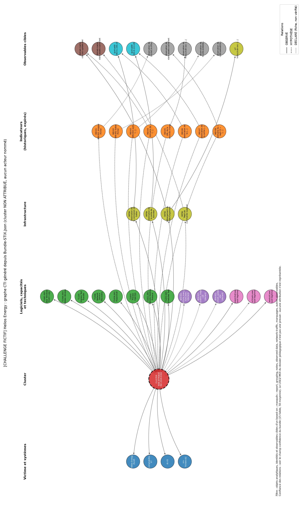

# Rapport tactique : intrusion INC-2026-0302 (Helios Energy, fictif)

**Destinataires : SOC et CTI. Version finale du 2026-10-07. Données fictives. Classification de travail : TLP:AMBER (voir la note de partage).**
Statuts : OBSERVÉ / CORROBORÉ / HYPOTHÈSE / INCONNU / NON TESTÉ. Chaque conclusion suit le schéma observation, preuve, interprétation, confiance, limite.

## 1. Résumé

Le dossier décrit, du 2 au 7 mars 2026 (**bornes d'observation, pas début ni fin certains**), une chaîne sur trois hôtes : exécution PowerShell masquée sur comptabilite-07, téléchargement d'un exécutable de 421376 octets, tâche planifiée, accès mémoire à LSASS et création d'un compte sur dc-01, sortie de 2 469 135 790 octets vers 203.0.113.28:8080, effacement du journal Security. **Cluster non attribué.** Les trois fiches de binaires ne s'accompagnent d'aucun échantillon. 21 incohérences du dossier sont documentées, dont un compte utilisé 36 h avant sa création.

## 2. Méthodologie et sources

Inventaire par script avec empreintes des 7 fichiers (originaux inchangés) ; analyse indépendante de chaque alerte avec **29 preuves relues automatiquement** dans les originaux ; techniques ATT&CK reconstruites puis vérifiées sur attack.mitre.org (ATT&CK v19, publiée le 28 avril 2026 ; v18.1 en vigueur lors de l'incident) ; cotation Admiralty séparant fiabilité de la source et crédibilité de l'information. Aucune valeur d'IoC n'a été transmise à un service tiers ; aucun binaire n'a été manipulé (il n'y en a pas).

## 3. Inventaire et intégrité

40 IoC (0 doublon, 0 invalide) ; 12 alertes (toutes retrouvées dans le journal brut) ; 3 fiches binaires (9 empreintes retrouvées dans le CSV) ; 1 mémo ; 1 journal brut de 372 lignes (12 utiles, 360 de bruit du 2 mars). Écarts majeurs : alerte 5 hors séquence, mémo daté avant les faits (I-02), compte svc-backup-temp utilisé avant sa création (I-03), source du RDP interne ou externe selon l'artefact (I-04), IP publique source d'un balayage interne (I-05), parent winword.exe pour un `.xlsm` (I-18). **Ces anomalies sont des défauts de données, pas des indices contre l'attaquant** ; les originaux n'ont pas été corrigés. Détail : `02-Artefacts/Integrite-et-provenance.md`.

## 4. Chronologie (extrait des observations)

| Heure UTC (03-0x) | Événement | Statut | Confiance |
|---|---|---|---|
| 03-02 06:40 | Domaine helios-energy-portal.test, première vue (IOC-017) | DECLARE | faible |
| 03-02 07:58 | Page d'hameçonnage mail-secure-login.test et son IP, première vue (IOC-015, IOC-023) | DECLARE | faible |
| 03-02 08:30 | Première apparition de BIN-001 (facture_mars_2026.xlsm), poste comptabilite-07 (IOC-040) | DECLARE | moyenne |
| 03-02 08:31 | winword.exe lance powershell.exe -enc (IEX) -w hidden | OBSERVE | élevée |
| 03-02 08:32 | Charge PowerShell déchiffrée, sha256 (IOC-010) | DECLARE | faible |
| 03-02 08:41 | Première vue de BIN-002 et du domaine de téléchargement (IOC-004, IOC-013) | DECLARE | moyenne |
| 03-02 08:42 | GET de svchost_update.exe, 200, 421376 octets | OBSERVE | élevée |
| 03-02 08:44 | Clé de registre Run\WinTelemetry, première vue (IOC-038) | DECLARE | faible |
| 03-02 08:46 | Création de la tâche MicrosoftEdgeUpdateTaskMachine | OBSERVE | moyenne |
| 03-02 09:16 | Connexion vers 198.51.100.24:443, 0,4 s, 812 octets, étiquetée beacon | OBSERVE | moyenne |
| 03-02 09:20 | Serveur de commande principal 203.0.113.14 et certificat CN=update-service, première vue | DECLARE | faible |
| 03-02 10:30 | Date d'en-tête du mémo « initial » | ANOMALIE | faible |
| 03-03 02:00 | IP de commande de repli 203.0.113.15, première vue | DECLARE | faible |
| 03-03 03:22 | static-assets-cache.test (même certificat) et 198.51.100.61 (passive DNS partagé avec D-04), premiè… | DECLARE | faible |
| 03-03 10:12 | 198.51.100.55, première vue | DECLARE | faible |
| 03-03 10:13 | Balayage 198.51.100.55 vers 10.20.0.0/16 sur 445 et 3389 | OBSERVE | élevée |
| 03-04 01:47 | 203.0.113.44, RDP entrant, première vue (IOC-026) | DECLARE | faible |
| 03-04 01:48 | 4624 type 10 pour svc-backup-temp sur srv-fichiers-02 | OBSERVE | moyenne |
| 03-04 11:04 | update-win-msft.test, première vue (IOC-018) | DECLARE | faible |
| 03-04 11:05 | CreateRemoteThread dans explorer.exe, région RWX, sur srv-fichiers-02 | OBSERVE | élevée |
| 03-04 11:06 | Module injecté (sha256 8772b487...), première vue (IOC-011) | DECLARE | faible |
| 03-05 14:05 | Première apparition de BIN-003 sur dc-01 | DECLARE | moyenne |
| 03-05 14:07 | Accès à lsass.exe, masque 0x1010 | OBSERVE | élevée |
| 03-05 14:10 | Création de svc-backup-temp selon le détail de l'alerte et IOC-037 | DECLARE | moyenne |
| 03-05 14:12 | 4720 création de svc-backup-temp (4726 « 45m later ») | OBSERVE | moyenne |
| 03-05 14:40 | Fichier C:\Windows\Temp\~df3a9.tmp, première vue | DECLARE | faible |
| 03-05 14:45 | Archive chiffrée (sha256 a0e1f129...), première vue | DECLARE | faible |
| 03-05 14:55 | Suppression de svc-backup-temp selon le détail ; 14:57 selon le calcul « 45m later » depuis 14:12 | DECLARE | moyenne |
| 03-05 15:30 | 203.0.113.28, première vue (IOC-024) | DECLARE | moyenne |
| 03-05 15:31 | Sortie de 2 469 135 790 octets vers 203.0.113.28:8080, cleartext | OBSERVE | moyenne |
| 03-06 03:10 | GET vers static-assets-cache.test, 200, annotation failover C2 | OBSERVE | faible à moyenne |
| 03-06 09:00 | 203.0.113.60 rapprochée d'un rapport public (D4) | DECLARE | très faible |
| 03-06 10:00 | Certificat pivot vers une campagne de janvier 2026 (C4) | DECLARE | très faible |
| 03-07 09:02 | 1102 journal Security effacé, wevtutil cl Security, sur comptabilite-07 | OBSERVE | élevée |

Les « premières vues » des IoC sont des dates de découverte, pas des heures d'événement. La chronologie dépend de HYP-001 (compte préexistant) et HYP-002 (horloges désalignées).

## 5. Analyse des 12 alertes

| Alerte | Hôte | Constat indépendant | Technique retenue | Confiance |
|---|---|---|---|---|
| 001 | comptabilite-07 | winword.exe lance powershell.exe -enc (préfixe = IEX) -w hidden ; parent incohérent avec un .xlsm | T1059.001 ; T1564.003 | élevée pour T1059.001 |
| 002 | comptabilite-07 | GET HTTP 200 d'un .exe de 421376 octets (taille = fiche BIN-02) ; exécution non démontrée | T1105 | élevée pour le transfert |
| 003 | comptabilite-07 | création de la tâche MicrosoftEdgeUpdateTaskMachine ; action de la tâche inconnue | T1053.005 | élevée pour la création |
| 004 | comptabilite-07 | UNE connexion 443 de 0,4 s, 812 octets ; périodicité non démontrée | T1071.001 | moyenne |
| 005 | dc-01 | accès à lsass.exe, masque 0x1010 (lecture mémoire) ; extraction effective non démontrée | T1003.001 | élevée pour l'accès |
| 006 | comptabilite-07 | balayage 445/3389 de 10.20.0.0/16 par 198.51.100.55 ; nature de la source inconnue | T1046 | élevée pour T1046 |
| 007 | srv-fichiers-02 | 4624 type 10 pour svc-backup-temp, source réseau absente ; compte créé 36 h plus tard | T1021.001 ; T1078 | moyenne pour T1021.001 |
| 008 | srv-fichiers-02 | CreateRemoteThread dans explorer.exe (RWX) : injection par thread distant ; hollowing non démontré | T1055 | élevée pour « injection par thread dist… |
| 009 | dc-01 | 4720 puis 4726 de svc-backup-temp sur dc-01 : création de compte, pas de service | T1136.002 | moyenne |
| 010 | dc-01 | 2 469 135 790 octets vers 203.0.113.28:8080 en clair ; contenu inconnu | T1048.003 | moyenne |
| 011 | srv-fichiers-02 | GET 200 vers static-assets-cache.test annoté « failover C2 » ; perte du C2 principal non montrée | T1008 ; T1071.001 | faible à moyenne |
| 012 | comptabilite-07 | 1102 + wevtutil cl Security : journal effacé (l'alerte dit « tentative ») | T1685.005 | élevée pour l'action et pour l'ID coura… |

Les techniques du SIEM ne sont pas reprises : **T1055.012 (alerte 8)** est contestée (la ligne exacte est `CreateRemoteThread into explorer.exe RWX region` ; le Process Hollowing crée un processus suspendu et n'est pas démontré ; on conclut à une injection par thread distant, T1055 au niveau parent) ; **T1543.003 (alerte 9)** est écartée (c'est la création d'un compte, 4720, donc T1136.002 probable) ; **T1070.001 est devenu T1685.005** dans ATT&CK v19. Le détail des 22 colonnes est dans `04-Analyse/Matrice-analyse-alertes.csv` ; fiches ci-dessous (observation, preuve, interprétation, confiance, limite).

### Alerte 1 : comptabilite-07 (2026-03-02T08:31:00Z)

- **Observation brute.** `2026-03-02T08:31:00Z comptabilite-07 Sysmon: Process Create: winword.exe -> powershell.exe -enc SQBFAFgA... -w hidden`
- **Preuve exacte.** 05_journaux_bruts.log:1 : « winword.exe -> powershell.exe -enc SQBFAFgA... -w hidden »
- **Interprétation.** OBSERVE : powershell.exe est un processus enfant de winword.exe avec -enc et -w hidden. Le préfixe base64 « SQBFAFgA » se décode (UTF-16LE) en « IEX » (Invoke-Expression) : décodage reproduit par nous ; le reste de la commande est tronqué (« ... ») donc la charge réelle est INCONNUE. Que ce soit une macro VBA, un courriel ou BIN-001 n'est pas dans la ligne : c'est déclaré par la fiche BIN-01 et le mémo. NOUVELLE CONTRADICTION : BIN-01 est un classeur .xlsm (Excel) mais le parent est winword.exe (Word).
- **Technique et statut.** T1059.001 [observée] : powershell.exe lancé, argument -enc | T1564.003 [observée] : argument -w hidden (fenêtre masquée) dans la même ligne | T1566.001 / T1204.002 / T1059.005 [non démontrée] : déclarées par la fiche BIN-01 seulement ; ni courriel ni ouverture de fichier ni code VBA dans les journaux fournis
- **Qualification, confiance.** OBSERVE (exécution) ; caractère malveillant : CORROBORE par ALERT-002 et la fiche (non indépendants entre eux) ; élevée pour T1059.001 ; moyenne pour la malveillance prise isolément.
- **Contradictions.** I-18 (parent winword.exe vs classeur .xlsm) ; première vue de BIN-01 08:30 vs événement 08:31 (1 min, cohérent)
- **À vérifier.** Ligne de commande complète (Sysmon EID 1, CommandLine non tronquée) ; processus parent réel (winword vs excel) ; journaux PowerShell (script block) ; courriel et pièce jointe sur la passerelle de messagerie ; compte exécutant.

### Alerte 2 : comptabilite-07 (2026-03-02T08:42:00Z)

- **Observation brute.** `2026-03-02T08:42:00Z comptabilite-07 Squid: GET https://cdn-svc-update.test/win/svchost_update.exe 200 421376`
- **Preuve exacte.** 05_journaux_bruts.log:2 : « GET https://cdn-svc-update.test/win/svchost_update.exe 200 421376 »
- **Interprétation.** OBSERVE : requête GET vers l'URL de l'exécutable, réponse 200, 421376 octets. CORROBORE : 421376 est exactement la taille déclarée de BIN-002 (fiche BIN-02) ; deux artefacts du même fournisseur, donc pas indépendants. NON DEMONTRE : que le fichier soit un PE (le journal ne dit rien du contenu), qu'il ait été exécuté, que le client soit powershell.exe (pas d'user-agent). Remarque technique : l'URL complète d'un flux HTTPS visible dans Squid suppose une interception TLS du proxy (HYP-010, non confirmée : limite).
- **Technique et statut.** T1105 [observée] : transfert HTTP 200 d'un exécutable depuis une URL externe
- **Qualification, confiance.** OBSERVE (transfert) + CORROBORE (taille) ; élevée pour le transfert ; faible pour le contenu et l'exécution.
- **Contradictions.** Aucune majeure. La résolution domaine vers 198.51.100.23 (IOC-019) est déclarée, non observée dans les journaux.
- **À vérifier.** User-agent et processus client ; journal DNS ; interception TLS du proxy ; copie en cache du fichier et son hash (comparaison à IOC-004) ; historique du domaine (requête tierce soumise à accord).

### Alerte 3 : comptabilite-07 (2026-03-02T08:46:00Z)

- **Observation brute.** `2026-03-02T08:46:00Z comptabilite-07 Sysmon: Scheduled Task Created: MicrosoftEdgeUpdateTaskMachine`
- **Preuve exacte.** 05_journaux_bruts.log:3 : « Scheduled Task Created: MicrosoftEdgeUpdateTaskMachine »
- **Interprétation.** OBSERVE : une tâche nommée MicrosoftEdgeUpdateTaskMachine est créée sur comptabilite-07 (ligne de journal). La commande schtasks /create ne figure que dans le détail de l'alerte, pas dans le journal brut. INCONNU : programme exécuté par la tâche, compte, planification ; donc l'usage comme persistance et le lien avec BIN-002 (déclaré par la fiche BIN-02) ne sont pas démontrés par cet événement. Réserve de format : le libellé « Sysmon: Scheduled Task Created » ne correspond pas, à ma connaissance, à un événement Sys…
- **Technique et statut.** T1053.005 [observée] : création d'une tâche planifiée
- **Qualification, confiance.** OBSERVE (création) ; persistance : HYPOTHESE ; élevée pour la création ; moyenne pour l'objectif malveillant.
- **Contradictions.** I-20 (commande dans l'alerte mais pas dans le journal ; libellé non standard). Deux mécanismes de persistance distincts (clé Run à 08:44, tâche à 08:46) sans alerte pour le premier.
- **À vérifier.** Security 4698 (XML de la tâche : action, utilisateur, déclencheur) ; comparaison avec les vraies tâches Edge sur un poste de référence ; valeur de la clé Run (IOC-038, valeur tronquée à « ... » dans la source).

### Alerte 4 : comptabilite-07 (2026-03-02T09:16:00Z)

- **Observation brute.** `2026-03-02T09:16:00Z comptabilite-07 Zeek: conn 198.51.100.24:443 duration=0.4 orig_bytes=812 (beacon)`
- **Preuve exacte.** 05_journaux_bruts.log:4 : « conn 198.51.100.24:443 duration=0.4 orig_bytes=812 (beacon) »
- **Interprétation.** OBSERVE : UNE seule connexion vers 198.51.100.24:443 (durée 0,4 s, 812 octets émis). NON DEMONTRE : la périodicité « ~300 s » (une seule ligne ; l'intervalle vient du texte de l'alerte et de la fiche BIN-02, c'est-à-dire de déclarations). L'étiquette « (beacon) » est celle de la source, pas une mesure. Le protocole applicatif n'est pas visible dans un journal de connexion Zeek : T1071.001 repose sur le port 443 et sur la fiche. Le lien domaine vers IP est déclaré (IOC-020), le journal ne montre que l'IP.
- **Technique et statut.** T1071.001 [probable] : connexion sortante en 443 (protocole applicatif non visible) ; chiffrement T1573 : déclaré par la fiche seulement
- **Qualification, confiance.** OBSERVE (1 connexion) ; balisage : HYPOTHESE FORTE non démontrée ; moyenne.
- **Contradictions.** I-12 (deux « C2 » distincts : 198.51.100.24 vu ici, 203.0.113.14 « principal » dans IOC-021). IOC-014 vu à 09:15, alerte et journal à 09:16 (1 min).
- **À vérifier.** Série complète des connexions Zeek vers cette IP depuis 08:41 (intervalle moyen, gigue de 20 % annoncée) ; ssl.log (SNI, certificat CN=update-service, JA3) ; DNS ; lien IOC-020.

### Alerte 5 : dc-01 (2026-03-05T14:07:00Z)

- **Observation brute.** `2026-03-05T14:07:00Z dc-01 Sysmon: Process Access: target=lsass.exe granted=0x1010 by rundll32_helper.dll`
- **Preuve exacte.** 05_journaux_bruts.log:8 : « target=lsass.exe granted=0x1010 by rundll32_helper.dll »
- **Interprétation.** OBSERVE : accès à lsass.exe avec le masque 0x1010, soit PROCESS_QUERY_LIMITED_INFORMATION (0x1000) + PROCESS_VM_READ (0x0010) : droits de lecture de la mémoire, compatibles avec une extraction d'identifiants. Ce masque n'est pas un indicateur suffisant seul (des outils de sécurité légitimes peuvent lire LSASS) ; la page ATT&CK T1003.001 cite d'ailleurs un autre masque (0x1F0FFF) comme exemple. NON DEMONTRE : qu'un identifiant ait été extrait ou réutilisé. « Non signé » (alerte) n'est pas dans la ligne de journal. …
- **Technique et statut.** T1003.001 [probable] : accès mémoire à lsass.exe observé (0x1010) ; extraction effective non démontrée
- **Qualification, confiance.** OBSERVE (accès) ; vol d'identifiants : HYPOTHESE FORTE ; élevée pour l'accès ; moyenne pour l'extraction.
- **Contradictions.** I-08 (une DLL n'est pas un processus) ; I-01 (alerte 5 hors séquence) ; « non signé » absent du journal (I-21)
- **À vérifier.** Sysmon EID 10 complet (SourceImage, CallTrace, GrantedAccess, session) ; processus réel et signature ; événements d'ouverture de session et de privilèges (4672, 4648) ; EDR ; échantillon BIN-003 (non fourni).

### Alerte 6 : comptabilite-07 (2026-03-03T10:13:00Z)

- **Observation brute.** `2026-03-03T10:13:00Z comptabilite-07 Zeek: scan detected 198.51.100.55 -> 10.20.0.0/16 dports=445,3389`
- **Preuve exacte.** 05_journaux_bruts.log:5 : « scan detected 198.51.100.55 -> 10.20.0.0/16 dports=445,3389 »
- **Interprétation.** OBSERVE : Zeek signale un balayage de la source 198.51.100.55 vers 10.20.0.0/16 sur les ports 445 et 3389 ; le nombre de cibles et de paquets n'est pas fourni. Le journal est émis par comptabilite-07 mais ne dit pas que comptabilite-07 EST la source. L'IP source est dans une plage de documentation, pas RFC 1918, alors que la cible est interne : INCONNU. Interprétations (HYP-003, HYP-004) : (a) pseudonymisation de l'IP interne du poste, alors IOC-025 serait un actif victime et ne devrait PAS devenir un blocage ni u…
- **Technique et statut.** T1046 [observée] : balayage de ports détecté sur 445 et 3389
- **Qualification, confiance.** OBSERVE (balayage) ; origine : INCONNU ; élevée pour T1046 ; faible pour l'attribution à comptabilite-07 ou à un tiers.
- **Contradictions.** I-05 (IP publique source d'un balayage interne) ; IOC-025 « depuis poste compromis » non étayé ; I-01 (ordre des alertes)
- **À vérifier.** IP interne réelle de comptabilite-07 (DHCP, CMDB) ; détail Zeek (notice.log, nombre de destinations) ; règles NAT et pare-feu entre zones ; topologie du site.

### Alerte 7 : srv-fichiers-02 (2026-03-04T01:48:00Z)

- **Observation brute.** `2026-03-04T01:48:00Z srv-fichiers-02 Security: 4624 Logon type=10 RDP account=svc-backup-temp time=01:47`
- **Preuve exacte.** 05_journaux_bruts.log:6 : « 4624 Logon type=10 RDP account=svc-backup-temp time=01:47 »
- **Interprétation.** OBSERVE : événement 4624 de type 10 (ouverture de session interactive à distance, soit RDP : type 10 = RemoteInteractive selon la documentation Microsoft, non revérifié le 2026-10-07) pour svc-backup-temp sur srv-fichiers-02 ; heure interne 01:47. La source réseau est ABSENTE du journal : l'alerte dit « interne inhabituelle », IOC-026 dit une IP externe : INCONNU (I-04). CONTRADICTION MAJEURE : ce compte est créé par 4720 le 2026-03-05 à 14:12, soit environ 36 h APRES cette session (I-03). Impact des lectures : (H…
- **Technique et statut.** T1021.001 [observée] : 4624 type 10 = connexion à distance interactive | T1078 (T1078.002 si compte de domaine) [probable] : usage d'un compte valide ; domaine ou local non indiqué
- **Qualification, confiance.** OBSERVE (événement) ; fiabilité de l'événement : CONTESTEE ; moyenne pour T1021.001 ; faible pour toute conclusion sur le compte.
- **Contradictions.** I-03 (compte utilisé avant sa création) ; I-04 (source interne vs externe) ; 4624 « time=01:47 » vs horodatage 01:48Z (1 min)
- **À vérifier.** IpAddress et WorkstationName du 4624 ; whenCreated du compte dans l'annuaire ; historique 4720/4726 complet ; NTP et fuseaux de srv-fichiers-02 et dc-01 ; authentifications Kerberos (4768/4769).

### Alerte 8 : srv-fichiers-02 (2026-03-04T11:05:00Z)

- **Observation brute.** `2026-03-04T11:05:00Z srv-fichiers-02 Sysmon: CreateRemoteThread into explorer.exe RWX region`
- **Preuve exacte.** 05_journaux_bruts.log:7 : « CreateRemoteThread into explorer.exe RWX region »
- **Interprétation.** LIBELLE ORIGINAL : « Injection de code dans un processus légitime », technique du SIEM T1055.012, sévérité Haute, détail « explorer.exe présente une région mémoire exécutable anormale ». LIGNE EXACTE : « 2026-03-04T11:05:00Z srv-fichiers-02 Sysmon: CreateRemoteThread into explorer.exe RWX region » (journal brut ligne 7). POURQUOI JE CONTESTE T1055.012 : selon la page ATT&CK (lue le 2026-10-06), le Process Hollowing consiste à créer un NOUVEAU processus suspendu puis à vider et remplacer sa mémoire ; il ne cible pa…
- **Technique et statut.** T1055 [observée (indice)] : CreateRemoteThread into explorer.exe, région RWX | T1055.001 / T1055.002 [non démontrée] : CreateRemoteThread est cité par ATT&CK pour ces sous-techniques ; la ligne ne les départage pas | T1055.012 [contestée / non démontrée] : aucun processus suspendu ni remplacement de mémoire dans l'artefact
- **Qualification, confiance.** OBSERVE (thread distant, RWX) ; sous-technique et initiateur : INCONNU ; élevée pour « injection par thread distant » ; faible pour toute sous-technique ; très faible pour l'attribution à BIN-002.
- **Contradictions.** I-06 (T1055.012 vs CreateRemoteThread) ; I-07 (BIN-002 récupéré sur comptabilite-07, injection sur srv-fichiers-02) ; fiche BIN-02 elle-même ambiguë
- **À vérifier.** Sysmon EID 8 complet (SourceImage, TargetImage, StartAddress, StartModule) et EID 10 ; arbre de processus ; image mémoire d'explorer.exe ; hash du module IOC-011 et son rapprochement avec BIN-002 ; recherche d'un événement de création de processus suspendu (t…

### Alerte 9 : dc-01 (2026-03-05T14:12:00Z)

- **Observation brute.** `2026-03-05T14:12:00Z dc-01 Security: 4720 User created svc-backup-temp / 4726 deleted 45m later`
- **Preuve exacte.** 05_journaux_bruts.log:9 : « 4720 User created svc-backup-temp / 4726 deleted 45m later »
- **Interprétation.** OBSERVE (selon une ligne qui condense deux événements) : 4720 (création d'utilisateur) et 4726 (suppression) pour svc-backup-temp, la seconde « 45m later » : l'heure du 4726 n'est pas fournie, elle est calculée. CONTESTATION DE T1543.003 : cette technique concerne la création ou modification de SERVICES Windows (page ATT&CK), pas un compte. Un événement 4720 est la création d'un compte ; la page ATT&CK de T1136.002 (Domain Account) cite justement 4720. Un compte créé sur un contrôleur de domaine est très probablem…
- **Technique et statut.** T1136.002 [probable] : 4720 sur dc-01 ; nature domaine non établie | T1543.003 [non démontrée] : aucun événement de service ; mapping SIEM suspect
- **Qualification, confiance.** OBSERVE (création/suppression de compte) ; objectif : HYPOTHESE ; moyenne.
- **Contradictions.** I-03 (compte utilisé 36 h avant) ; I-09 (14:10/14:12, 14:55/14:57) ; mapping SIEM T1543.003 incohérent avec 4720
- **À vérifier.** Événement 4720 complet (créateur, SID, UPN) ; 4728/4732/4756 (groupes) ; 4726 avec son heure réelle ; whenCreated ; 7045/4697 sur dc-01 ; journal Directory Service.

### Alerte 10 : dc-01 (2026-03-05T15:31:00Z)

- **Observation brute.** `2026-03-05T15:31:00Z dc-01 Zeek: large outbound 203.0.113.28:8080 bytes=2469135790 cleartext`
- **Preuve exacte.** 05_journaux_bruts.log:10 : « 203.0.113.28:8080 bytes=2469135790 cleartext »
- **Interprétation.** OBSERVE : sortie de 2 469 135 790 octets vers 203.0.113.28:8080 depuis dc-01 (2,47 Go décimal ou 2,30 Gio ; l'alerte dit « 2,3 Go » sans préciser l'unité : I-10). NON DEMONTRE : le contenu, le lien avec l'archive (IOC-012/039 : lien TEMPOREL 14:40 à 15:31, déclaré par la fiche BIN-03 et IOC-024), la direction exacte du champ « bytes= », le protocole applicatif. INCONNU : l'étendue des données exfiltrées (le mémo le dit) et comment des données de serveurs de fichiers seraient arrivées sur dc-01 (HYP-007). T1041 (ex…
- **Technique et statut.** T1048.003 [probable] : sortie en clair (« cleartext ») sur 8080 vers une IP distincte des IP C2
- **Qualification, confiance.** OBSERVE (volume) ; exfiltration de données : HYPOTHESE FORTE ; moyenne.
- **Contradictions.** I-10 (unités) ; fiche BIN-03 situe l'archive sur le DC alors que le mémo parle de serveurs de fichiers
- **À vérifier.** Zeek conn.log (orig_bytes vs resp_bytes, durée, history) ; http.log ou PCAP ; taille de l'archive staging ; service sur 8080 ; journal de pare-feu.

### Alerte 11 : srv-fichiers-02 (2026-03-06T03:10:00Z)

- **Observation brute.** `2026-03-06T03:10:00Z srv-fichiers-02 Squid: GET https://static-assets-cache.test/ 200 (failover C2)`
- **Preuve exacte.** 05_journaux_bruts.log:11 : « GET https://static-assets-cache.test/ 200 (failover C2) »
- **Interprétation.** OBSERVE : un GET vers https://static-assets-cache.test/ depuis srv-fichiers-02, réponse 200 (taille absente). Le caractère « repli C2 » est une annotation de la source (« (failover C2) ») : aucune ligne ne montre la perte du C2 principal ni un schéma de balise vers ce domaine. NON DEMONTRE : que ce soit du C2, que le client soit BIN-002 (HYP-005), le processus client. L'infrastructure de repli (IOC-016, IOC-022) est « vue » dès le 3 mars, trois jours AVANT cet événement (I-11) : cela peut être légitime (infrastruc…
- **Technique et statut.** T1008 [probable] : annotation « failover C2 » seule ; sans perte démontrée du canal primaire, la technique reste faiblement étayée | T1071.001 [probable] : requête web 200
- **Qualification, confiance.** OBSERVE (requête) ; repli C2 : HYPOTHESE ; faible à moyenne.
- **Contradictions.** I-11 (infrastructure de repli vue le 3 mars) ; I-07 (hôte srv-fichiers-02 vs BIN-002 sur comptabilite-07)
- **À vérifier.** Journaux proxy du C2 principal entre le 5 et le 6 mars (échecs) ; DNS ; certificat TLS du repli (comparaison avec CN=update-service) ; user-agent ; processus client.

### Alerte 12 : comptabilite-07 (2026-03-07T09:02:00Z)

- **Observation brute.** `2026-03-07T09:02:00Z comptabilite-07 Security: 1102 audit log cleared / wevtutil cl Security`
- **Preuve exacte.** 05_journaux_bruts.log:12 : « 1102 audit log cleared / wevtutil cl Security »
- **Interprétation.** OBSERVE : événement 1102 (journal d'audit effacé) et la commande wevtutil cl Security sur comptabilite-07. L'intitulé de l'alerte parle de « tentative » mais 1102 est produit après un effacement : l'effacement semble avoir ABOUTI (I-19). CONSEQUENCE : les événements Security antérieurs de ce poste peuvent être perdus : l'absence d'événements Security sur comptabilite-07 n'est pas une preuve d'absence. NON DEMONTRE : l'auteur, le processus, la présence continue de l'attaquant (HYP-008).
- **Technique et statut.** T1685.005 [observée] : 1102 + wevtutil cl Security ; la page officielle cite wevtutil cl security ; ancien ID T1070.001 (<= v18) devenu T1685.005 en v19
- **Qualification, confiance.** OBSERVE ; élevée pour l'action et pour l'ID courant (T1685.005, vérifié ; le validateur pySigma signale T1070.001 comme invalide).
- **Contradictions.** I-19 (« tentative » vs 1102) ; identifiant ATT&CK renuméroté (T1070.001 -> T1685.005) ; le mémo daté du 2 mars ne peut pas connaître cet événement (I-02)
- **À vérifier.** Compte et processus (Sysmon EID 1, 4688) ; copie des journaux dans le SIEM avant effacement ; état des autres journaux ; contrôle d'autres effacements (104 pour System).

## 6. Analyse des fiches binaires (« analyse des fiches fournies »)

BIN-001 (dropper, 68242 o), BIN-002 (balise, 421376 o, taille corroborée par le journal), BIN-003 (outil LSASS générique selon la fiche). Aucun hash n'est recalculable. Capacités supposées non démontrées : périodicité de 300 s et gigue de 20 % (une seule ligne de balise), hollowing, service Windows, chiffrement du canal.

## 7. Corrélations

| Lien | Nature | Statut |
|---|---|---|
| fiches = CSV (9 empreintes) ; taille 421376 fiche = journal | égalité exacte (même fournisseur) | CORROBORÉ |
| domaine → IP, certificat partagé, passive DNS | relation déclarée | DÉCLARÉ, non exploitable |
| séquences d'horodatages sur un hôte ou entre hôtes | lien temporel | HYPOTHÈSE |
| LSASS, compte, archive, sortie (14:07 à 15:31) | temporel + fiche | HYPOTHÈSE forte |
| MISP, OpenCTI | 0 corrélation externe, 0 entité préexistante | aucun |

## 8. Matrice ATT&CK (alertes uniquement)

| Technique | Nom (ATT&CK v19) | Statut | Alertes |
|---|---|---|---|
| T1003.001 | OS Credential Dumping: LSASS Memory | ALERT-005 probable | 2 |
| T1008 | Fallback Channels | ALERT-011 probable | 2 |
| T1021.001 | Remote Services: Remote Desktop Protocol | ALERT-007 observée | 1 |
| T1046 | Network Service Discovery | ALERT-006 observée | 1 |
| T1048.003 | Exfiltration Over Alternative Protocol: Exfiltratio… | ALERT-010 probable | 1 |
| T1053.005 | Scheduled Task/Job: Scheduled Task | ALERT-003 observée | 1 |
| T1055 | Process Injection | ALERT-008 observée | 1 |
| T1055.001 | Process Injection: Dynamic-link Library Injection | ALERT-008 non démontrée | 2 |
| T1055.002 | Process Injection: Portable Executable Injection | ALERT-008 non démontrée | 2 |
| T1055.012 | Process Injection: Process Hollowing | ALERT-008 contestée / non dém… | 1 |
| T1059.001 | Command and Scripting Interpreter: PowerShell | ALERT-001 observée | 1 |
| T1071.001 | Application Layer Protocol: Web Protocols | ALERT-004 probable | 3 |
| T1078 | Valid Accounts | ALERT-007 probable | 2 |
| T1105 | Ingress Tool Transfer | ALERT-002 observée | 1 |
| T1136.002 | Create Account: Domain Account | ALERT-009 probable | 2 |
| T1543.003 | Create or Modify System Process: Windows Service | ALERT-009 non démontrée | 2 |
| T1564.003 | Hide Artifacts: Hidden Window | ALERT-001 observée | 1 |
| T1685.005 | Disable or Modify Tools: Clear Windows Event Logs | ALERT-012 observée | 3 |

*Version ATT&CK : v19 (publiée le 28 avril 2026), lue sur attack.mitre.org le 2026-10-06. Au moment de l'incident (mars 2026), la version en vigueur était la v18.1 : T1685.005 s'appelait alors T1070.001. Détail : `04-Analyse/Version-ATTACK.md`.*

Statuts : « observée » = preuve directe dans un artefact ; « probable » = compatible mais non démontrée (T1003.001, T1071.001, T1008, T1048.003, T1136.002, T1078 : décrites, **non** rattachées dans les graphes).

## 9. Diamond Model

Adversaire INCONNU ; capacités : chaîne PowerShell, implant déclaré, accès LSASS, RDP, effacement de journal ; infrastructure : domaines `.test` et IP RFC 5737 (rôles non démontrés) ; victime : comptabilite-07, srv-fichiers-02, dc-01. Voir `04-Analyse/Diamond-Model.md`.

## 10. Attribution et alternatives

Aucune observation n'est discriminante. Hypothèses comparées : cluster cybercriminel à outillage recoupant une famille connue (affirmation de la fiche, non vérifiable, faible), opérateur opportuniste (compatible), acteur étatique (non soutenu, non exclu). **Conclusion : cluster non attribué.** Confiance élevée dans cette conclusion, faible dans l'hypothèse d'une finalité lucrative (non discriminante : la même chaîne sert l'espionnage). L'indication d'attribution du LISEZ-MOI du dossier pédagogique est consignée à part et n'est pas une preuve. Biais surveillés : confirmation, notoriété, sélection.

## 11. Détection

15 règles Sigma (11 DIRECTES fondées sur un artefact, 3 IOC, 1 CHASSE) : `07-Detection-Tests/sigma/`. Les règles IOC et de chasse **ne prouvent aucune technique observée**.

| DET | Règle | Fondement | Tests réels / synthétiques+ / négatifs | Résultat |
|---|---|---|---|---|
| DET-001 | Office lançant PowerShell encodé et masqué | DIRECTE | 2 positifs / 14 négatifs | 0 écart (16 événements du logsource) |
| DET-002 | Chasse : PowerShell encodé dont le préfixe décodé est I… | CHASSE | 2 positifs / 14 négatifs | 0 écart (16 événements du logsource) |
| DET-003 | Téléchargement d'un exécutable par GET avec réponse 200… | DIRECTE | 2 positifs / 5 négatifs | 0 écart (7 événements du logsource) |
| DET-004 | Requête proxy vers un domaine du dossier (IoC non vérif… | IOC | 3 positifs / 4 négatifs | 0 écart (7 événements du logsource) |
| DET-005 | Création de tâche planifiée imitant la mise à jour Edge | DIRECTE | 2 positifs / 14 négatifs | 0 écart (16 événements du logsource) |
| DET-006 | Connexion vers une IP du dossier (IoC non vérifiés) | IOC | 3 positifs / 3 négatifs | 0 écart (6 événements du logsource) |
| DET-007 | Accès à LSASS avec droits de lecture mémoire (0x1010) | DIRECTE | 2 positifs / 2 négatifs | 0 écart (4 événements du logsource) |
| DET-008 | Balayage détecté par Zeek sur SMB et RDP | DIRECTE | 2 positifs / 1 négatifs | 0 écart (3 événements du logsource) |
| DET-009 | Connexion RDP (type 10) d'un compte de service | DIRECTE | 2 positifs / 8 négatifs | 0 écart (10 événements du logsource) |
| DET-010 | Thread distant créé dans explorer.exe | DIRECTE | 2 positifs / 2 négatifs | 0 écart (4 événements du logsource) |
| DET-011 | Création d'un compte dont le nom finit par -temp | DIRECTE | 2 positifs / 8 négatifs | 0 écart (10 événements du logsource) |
| DET-012 | Sortie réseau supérieure à 1 Go | DIRECTE | 2 positifs / 4 négatifs | 0 écart (6 événements du logsource) |
| DET-013 | Effacement du journal Security (1102) | DIRECTE | 1 positifs / 9 négatifs | 0 écart (10 événements du logsource) |
| DET-014 | Commande wevtutil cl Security | DIRECTE | 2 positifs / 14 négatifs | 0 écart (16 événements du logsource) |
| DET-015 | Processus portant un nom de fichier du dossier (fiches … | IOC | 2 positifs / 14 négatifs | 0 écart (16 événements du logsource) |

**Niveaux de test distincts.** (1) Validation syntaxique : pySigma 1.5.1, 15 règles, 0 alerte de validation après correction de l'identifiant ATT&CK (le validateur a signalé T1070.001 comme invalide, ce qui a révélé la renumérotation). (2) Conversion : backend SQLite, pipeline de renommage de champs (outil de test, pas un déploiement). (3) Test sur événement : base de 410 événements (15 du dossier ou des fiches, 13 positifs synthétiques, 22 négatifs synthétiques, 360 lignes de bruit du dossier) : **0 écart, 0 faux positif sur 410 événements testés** ; les jeux synthétiques sont écrits par l'équipe et ne mesurent aucun taux de production. (4) Wazuh : les décodeurs et règles XML (130101 à 130115) sont des **adaptations manuelles**, pas une conversion. `wazuh-logtest` dans un conteneur de test isolé (sans réseau) : 26 événements conformes sur 45 au premier passage (19 écarts), puis 40 sur 45, puis 45 sur 45 : trois passes de logtest et deux corrections des décodeurs, après deux erreurs de syntaxe signalées par `wazuh-analysisd -t` (champs statiques réservés `url`, `status`, `user` ; limites de la syntaxe OS_Regex ; décodeurs enfants sans prématch ; regex PCRE2) ; rejeu de bout en bout isolé : 27 alertes pour 27 positifs, 0 pour 18 négatifs. En **production** (déploiement ciblé de 2 fichiers, niveaux 4 à 7 pour rester sous le seuil 10 de l'intégration TheHive, redémarrage du manager de 41 s) : `wazuh-logtest` 45 sur 45, rejeu par l'API (3 événements puis 42), **27 alertes** générées, 0 pour les 18 négatifs, **27 documents** retrouvés dans l'indexeur (`wazuh-alerts-4.x-2026.10.06`, groupe `helios_challenge`). Contrôle du dashboard : exécuté le 2026-10-06 en revue de clôture (Discover, `wazuh-alerts-*`, filtre `rule.groups:helios_challenge` : 27 hits). Différences de logique Sigma vers Wazuh : un événement ne produit qu'une alerte (ombrage, 3 cas : W01, W02, W10) ; DET-005 adaptée au nom de tâche ; seuil d'octets approché par 10 chiffres ; pas de normalisation de chemins.

## 12. Plateformes et méthodes d'intégration (état réel)

- **MISP** (production, organisation dédiée CHALLENGE-FICTIF, distribution 0, non publié) : événement 6, 30 attributs + 5 objets (46 attributs), 8 galaxies ATT&CK observées, 0 attribut to_ids, 0 corrélation. **Méthode : API REST** depuis l'hôte MISP avec un utilisateur Publisher dédié ; l'organisation propriétaire a été créée par une **insertion SQL directe, exception documentée et non recommandée**. Écarts : hostname refusé (nom sans point, stocké en texte), taille hors objet, chemin Windows normalisé par MISP, étiquettes personnalisées non créées (droits Publisher).
- **OpenCTI** (production) : 1 rapport (103 objets) + 3 notes (Analyses) ; 1 incident + 4 données observées + 4 détections (Événements) ; 27 observables + 8 indicateurs expirés (Observations) ; 1 enquête (56 entités, 30 relations existantes) et 5 RFI ouvertes sans réponse ; TLP:RED partout, aucun domaine créé comme observable. **Méthode : API GraphQL** (scripts idempotents, jeton d'administration lu dans le conteneur), **ni par le connecteur MISP** (en marche mais sans interrogation de MISP, non repris) **ni par import du bundle**. Contrôle par API et dans l'interface les 2026-10-06 et 2026-10-07 ; réserves : le graphe de connaissance est sur le rapport (pas d'écran graphe pour l'incident), onglet Indicateurs de l'incident vide (relations `related-to`).
- **Wazuh** (production) : 14 décodeurs et 15 règles (130101 à 130115, niveaux 4 à 7) ajoutés comme fichiers nouveaux ; **chemin de test** : logtest en conteneur isolé, logtest en production, rejeu par l'API `POST /events` ; 27 alertes indexées, consultables par `rule.groups: helios_challenge`.
- **STIX** : 152 objets dérivés de l'export MISP réel (`restSearch` STIX 2.1) et d'enrichissements documentés, **non importés** dans une plateforme ; stix2-validator : valide, 0 erreur, 218 avertissements classés (82 identifiants déterministes assumés, 117 propriétés de provenance x_helios_ assumées, 19 bonnes pratiques) ; 548 références résolues. Objets liés : **27 objets de renseignement** (campagne, malwares, outils, infrastructures, techniques, indicateurs) reliés dans une même composante, dont 7 ajoutés le 2026-10-07 sur preuve du journal brut ou des alertes ; 25 si l'on retire les 2 dont la seule base est le texte d'une alerte. Méthode conservatrice de l'équipe, non confirmée par le commanditaire.
- **Non utilisés** : TheHive (aucun objet créé ni importé, vérifié en lecture seule) et Cortex (aucun job pour la mission) ne contribuent à aucun résultat. Détail : `05-Plateformes/Methodes-integration-et-import.md`.

## 13. Confinement et investigations complémentaires

Recommandations conditionnelles (non exécutées, victime fictive) : isoler comptabilite-07 et conserver son image avant remise en état ; rechercher les traces de la tâche `MicrosoftEdgeUpdateTaskMachine` et de la clé Run sur les hôtes du /16 ; revoir les comptes privilégiés si l'extraction LSASS est confirmée ; filtrer le trafic sortant en clair sur 8080 depuis les contrôleurs de domaine ; récupérer les journaux Sysmon, Zeek et proxy complets. À obtenir : échantillons, source du RDP, contenu de la sortie, horloges, date réelle de création de svc-backup-temp, journaux de messagerie.

## 14. Limites

Aucun échantillon ; une seule ligne de balise ; journal Security de comptabilite-07 effacé (absence d'événements ≠ absence d'activité) ; dates = bornes ; cotations sans source indépendante ; tests Sigma et Wazuh sur jeux écrits par l'équipe ; interfaces contrôlées les 2026-10-06 et 2026-10-07 avec réserves (onglet Indicateurs de l'incident vide) ; ATT&CK v19 non encore reflété dans MISP (galaxie T1070.001), Wazuh (T1685.005 inconnue de sa base MITRE, avertissement non bloquant) ni dans certaines entités OpenCTI.

## 15. Références

Règles Sigma complètes : `07-Detection-Tests/sigma/DET-001` à `DET-015`. Registre et résultats : `07-Detection-Tests/Registre-regles.csv`, `Resultats-tests.csv`, `resultats/`. Bundle : `06-STIX-Graphe/Bundle-STIX.json`. Graphe : `06-STIX-Graphe/Graphe-CTI.pdf` (vectoriel) et `Graphe-CTI.png`. Analyse : `04-Analyse/`.

**Annexe : graphe CTI généré depuis le bundle, pivoté de 90° (tourner la page pour le lire).** Version vectorielle lisible : `06-STIX-Graphe/Graphe-CTI.pdf`.

