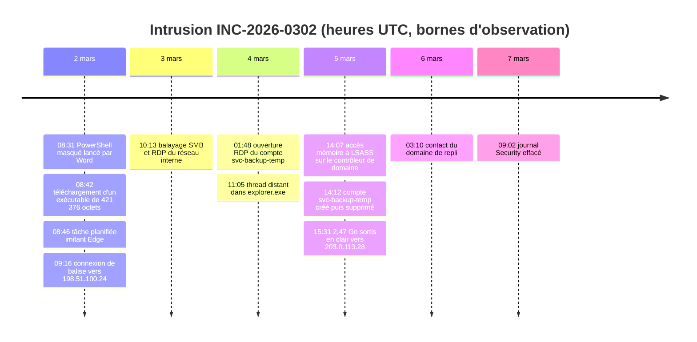

# Résumé de la documentation : points à valider et documents de référence

Mission : investigation CTI de l'incident INC-2026-0302 chez Helios Energy (victime fictive, statut d'opérateur d'importance vitale fourni par l'énoncé). Ce document réunit **tous les points à valider** et renvoie, pour chacun, vers le document qui explique tout. Les liens sont relatifs, à ouvrir depuis le dépôt.

Vues d'ensemble : [README](../README.md) (carte du dossier) · [Clôture finale](../11-Validation/Cloture-finale-mission.md) (état de chaque élément) · [Audit des critères](../11-Validation/Audit-final-criteres.md) (36 exigences une par une) · [Tableau de bord](../00-Pilotage/Tableau-de-bord.md).

## Le message en trois phrases

1. Un intrus a agi sur un poste de la comptabilité, puis sur un serveur et le contrôleur de domaine, a fait sortir environ 2,5 Go en clair et a effacé des traces, entre le 2 et le 7 mars 2026 (bornes d'observation, pas début ni fin certains).
2. Les faits suffisent pour **agir** (chasser, isoler, qualifier les données sorties, examiner la notification) mais pas pour **accuser** : le groupe reste **non attribué**.
3. Tout ce qui est affirmé renvoie à un artefact du dossier. Les manques sont écrits : aucun échantillon de binaire, aucune source indépendante, aucune relecture par un tiers.

<!-- TIMELINE:DEBUT (généré par 04-Analyse/generer-timeline.py : ne pas modifier à la main) -->
## Chronologie de l'incident

Du 2 au 7 mars 2026 (bornes d'observation, pas début ni fin certains). Heures UTC. Chaque ligne repose sur une alerte retrouvée dans le journal brut.

| # | Date et heure (UTC) | Phase | Hôte | Ce qui est observé | Technique ATT&CK | Confiance | Preuve |
|---|---|---|---|---|---|---|---|
| 1 | 02/03 08:31 | Exécution | `comptabilite-07` | PowerShell masqué lancé par Word | T1059.001 PowerShell (observée) ; T1564.003 Hidden Window (observée) | élevée | [ALERT-001](../04-Analyse/Matrice-analyse-alertes.csv) |
| 2 | 02/03 08:42 | Chargement d'outil | `comptabilite-07` | Téléchargement d'un exécutable de 421 376 octets | T1105 Ingress Tool Transfer (observée) | élevée | [ALERT-002](../04-Analyse/Matrice-analyse-alertes.csv) |
| 3 | 02/03 08:46 | Persistance | `comptabilite-07` | Tâche planifiée imitant Edge | T1053.005 Scheduled Task (observée) | moyenne | [ALERT-003](../04-Analyse/Matrice-analyse-alertes.csv) |
| 4 | 02/03 09:16 | Commande et contrôle | `comptabilite-07` | Connexion de balise vers 198.51.100.24 | T1071.001 Web Protocols (probable) | moyenne | [ALERT-004](../04-Analyse/Matrice-analyse-alertes.csv) |
| 5 | 03/03 10:13 | Découverte | `comptabilite-07` | Balayage SMB et RDP du réseau interne | T1046 Network Service Discovery (observée) | élevée | [ALERT-006](../04-Analyse/Matrice-analyse-alertes.csv) |
| 6 | 04/03 01:48 | Mouvement latéral | `srv-fichiers-02` | Ouverture RDP du compte svc-backup-temp | T1021.001 Remote Desktop Protocol (observée) ; T1078 Valid Accounts (probable) | moyenne | [ALERT-007](../04-Analyse/Matrice-analyse-alertes.csv) |
| 7 | 04/03 11:05 | Injection de code | `srv-fichiers-02` | Thread distant dans explorer.exe | T1055 Process Injection (observée) | élevée | [ALERT-008](../04-Analyse/Matrice-analyse-alertes.csv) |
| 8 | 05/03 14:07 | Accès aux identifiants | `dc-01` | Accès mémoire à LSASS sur le contrôleur de domaine | T1003.001 LSASS Memory (probable) | élevée | [ALERT-005](../04-Analyse/Matrice-analyse-alertes.csv) |
| 9 | 05/03 14:12 | Persistance (compte) | `dc-01` | Compte svc-backup-temp créé puis supprimé | T1136.002 Domain Account (probable) | moyenne | [ALERT-009](../04-Analyse/Matrice-analyse-alertes.csv) |
| 10 | 05/03 15:31 | Exfiltration | `dc-01` | 2,47 Go sortis en clair vers 203.0.113.28 | T1048.003 Exfiltration Over Unencrypted Non-C2 Protocol (probable) | moyenne | [ALERT-010](../04-Analyse/Matrice-analyse-alertes.csv) |
| 11 | 06/03 03:10 | Commande et contrôle (repli) | `srv-fichiers-02` | Contact du domaine de repli | T1008 Fallback Channels (probable) ; T1071.001 Web Protocols (probable) | faible à moyenne | [ALERT-011](../04-Analyse/Matrice-analyse-alertes.csv) |
| 12 | 07/03 09:02 | Effacement des traces | `comptabilite-07` | Journal Security effacé | T1685.005 Clear Windows Event Logs (observée) | élevée | [ALERT-012](../04-Analyse/Matrice-analyse-alertes.csv) |

**Lecture** : entrée par un document Office qui lance PowerShell masqué sur le poste de la comptabilité (2 mars), puis balayage interne (3 mars), rebond RDP et injection sur un serveur (4 mars), accès aux identifiants et sortie de 2,47 Go depuis le contrôleur de domaine (5 mars), canal de repli (6 mars), effacement du journal de sécurité (7 mars). Le compte `svc-backup-temp` est utilisé 36 heures avant sa création : anomalie signalée, non résolue.

**Détail complet** : [Chronologie de présentation, avec anomalies et repères déclarés](../04-Analyse/Timeline-incident.md) · [Chronologie.csv (34 événements)](../04-Analyse/Chronologie.csv) · [Matrice ATT&CK](../04-Analyse/Matrice-ATTACK.csv) · [Analyse des alertes](../04-Analyse/Analyse-alertes.md)
<!-- TIMELINE:FIN -->

---

# A. Points à valider

## A1. Les 11 livrables obligatoires

| # | Livrable | Critère de validation | État | Document | Réserve |
|---|---|---|---|---|---|
| 1 | Note de cadrage (2 pages, fin J1) | rendue à temps, validée par le commanditaire | Livré (2 pages) | [PDF](../01-Cadrage/Note-cadrage.pdf) · [section 1](#1-cadrage-et-périmètre) | remise après l'échéance de fin J1 ; validation du commanditaire en attente |
| 2 | Rapport stratégique (PDF, 2 à 3 pages) | un non-technicien comprend l'impact et les décisions à prendre | Livré (2 pages) | [PDF](../08-Rapports/Rapport-strategique.pdf) · [section 12](#12-rapport-stratégique--ce-que-la-direction-doit-décider) | lecture par la direction en attente |
| 3 | Rapport tactique SOC (PDF, 8 à 12 pages) | au moins 10 règles Sigma déployables, pas seulement listées | Livré (11 pages, 15 règles) | [PDF](../08-Rapports/Rapport-tactique.pdf) · [section 13](#13-détection--les-15-règles-sigma) | règles validées, converties, testées et adaptées en règles Wazuh déployées ; une adaptation reste à prévoir pour des journaux Windows réels |
| 4 | Bundle STIX 2.1 (JSON) | au moins 25 objets liés depuis MISP ; chaque objet porte sa source et sa date de collecte | Livré (152 objets, 27 liés) | [Bundle](../06-STIX-Graphe/Bundle-STIX.json) · [section 16](#16-bundle-stix-21) | source et date présentes sur 152 objets sur 152 ; la définition de « objets liés » n'est pas confirmée par le commanditaire (RFI-05) |
| 5 | Graphe du renseignement (PNG ou PDF) | généré depuis le bundle, pas fait à la main | Livré | [PDF](../06-STIX-Graphe/Graphe-CTI.pdf) · [PNG](../06-STIX-Graphe/Graphe-CTI.png) · [section 17](#17-graphe-du-renseignement) | aucune |
| 6 | Note d'attribution | cotation Admiralty et biais exposés ; un cluster prudent vaut mieux qu'un nom non prouvé | Livré (2 pages, cluster non attribué) | [PDF](../08-Rapports/Note-attribution.pdf) · [section 10](#10-attribution) | aucune source indépendante disponible |
| 7 | Matrice de risques CID | impact C / I / D par actif touché, criticité argumentée | Livré (5 actifs) | [PDF](../04-Analyse/Matrice-risques-CID.pdf) · [section 11](#11-impact-sur-les-actifs-matrice-cid) | plusieurs rôles d'actifs déduits du nom d'hôte |
| 8 | Note réglementaire ANSSI (1 page) | qualification, quoi déclarer, à qui, délai ; cohérente avec le statut OIV | Livré (1 page) | [PDF](../08-Rapports/Note-reglementaire-ANSSI.pdf) · [section 19](#19-note-réglementaire-anssi) | système d'importance vitale et secteur non fournis ; relecture juridique avant tout usage réel |
| 9 | Note de partage communautaire (1 page) | partageable ou interne, classification TLP justifiée par catégorie | Livré (1 page) | [PDF](../08-Rapports/Note-partage-communautaire.pdf) · [section 20](#20-partage-communautaire-et-tlp) | glossaire TLP du sujet non fourni |
| 10 | Volet optionnel Wazuh | mono-nœud, rejeu des logs, Sigma vers règles Wazuh ; tableau par règle : déclenche, faux positifs, ajustement | Livré (15 règles, 27 alertes) | [Tableau par règle](../07-Detection-Tests/Plan-tests.md) · [section 14](#14-volet-wazuh-optionnel) | jeux de test écrits par l'équipe : pas de taux de faux positifs de production |
| 11 | Soutenance (20 min + 10 questions) | défense de l'attribution et du niveau de confiance sous pression | Support prêt (15 diapositives, 18 questions préparées) | [Plan](Plan-soutenance.md) · [Support](Support-soutenance.pdf) · [Questions](Questions-reponses.md) | non répétée à voix haute |

## A2. Les exigences transverses

| Exigence | Application | État | Document |
|---|---|---|---|
| Artefacts d'abord | chaque technique ATT&CK citée se rattache à une alerte et une ligne de journal ; aucune technique recopiée d'un rapport public | Tenue | [Matrice ATT&CK](../04-Analyse/Matrice-ATTACK.csv) · [section 8](#8-cartographie-attck) |
| Admiralty partout | les 40 IoC sont cotés (fiabilité A à F séparée de la crédibilité 1 à 6) dans l'analyse, dans MISP (commentaire de chaque attribut) et dans STIX | Tenue | [Cotes Admiralty](../02-Artefacts/Cotes-Admiralty-IoC.csv) · [section 5](#5-analyse-des-ioc-et-cotation-admiralty) |
| MISP structuré | 5 objets, 8 galaxies ATT&CK, tag TLP, relation entre objets ; relations et STIX dérivés | Tenue, avec réserve : pas de galaxie d'acteur (cluster non attribué) ; cote Admiralty en commentaire car la taxonomie est désactivée dans l'instance | [Vérification MISP](../05-Plateformes/Verification-MISP.md) · [section 15](#15-misp) |
| Double cartographie | chaque action d'attaque figure dans la matrice ATT&CK et dans le Diamond Model | Tenue | [Diamond](../04-Analyse/Diamond-Model.md) · [section 9](#9-diamond-model) |
| Dark web consultatif | 4 consultations horodatées de sources en clair, aucune interaction, aucun achat, aucune valeur du dossier envoyée | Tenue, avec réserve : consultation indirecte, aucun accès direct aux services `.onion` | [Note dark web](../03-Sources/Darkweb-consultatif.md) · [section 4](#4-consultation-du-dark-web) |

## A3. Demandes supplémentaires et volets optionnels

| Élément | État | Document |
|---|---|---|
| Mission consultable dans OpenCTI (Analyses, Événements, Observations) | Livré | [Guide de consultation](../05-Plateformes/Guide-consultation-OpenCTI.md) · [section 18](#18-opencti) |
| Enquête OpenCTI | Livrée, lisibilité limitée (vue synthétique) | [Investigation finale](../05-Plateformes/Investigation-OpenCTI-finale.md) |
| 5 demandes d'information (RFI) OpenCTI | Créées, ouvertes, sans réponse | [Suivi des RFI](../00-Pilotage/Suivi-RFI.md) |
| Correspondance MISP / OpenCTI | Démontrée par comparaison de valeurs, sans synchronisation par connecteur | [Écarts bundle et plateformes](../06-STIX-Graphe/Ecarts-bundle-plateformes.md) |
| Cortex, CrowdSec | Non utilisés, justifiés | [Cortex](../05-Plateformes/Verification-Cortex.md) · [TheHive](../05-Plateformes/Verification-TheHive.md) |

## A4. Éléments non satisfaits ou partiels

| Élément | État | Cause | Document |
|---|---|---|---|
| Analyse statique des 3 binaires | Non réalisée | les échantillons n'ont pas été fournis, seulement 3 fiches (RFI-01 ouverte) | [Analyse des fiches](../04-Analyse/Analyse-binaires.md) |
| Note de cadrage à l'heure | Partiel | produite après l'échéance de fin J1 | [Note de cadrage](../01-Cadrage/Note-cadrage.md) |
| Dépôt Git `cti-helios-energy` | À créer en fin de mission, par l'utilisateur | exigence du sujet ; procédure prête | [Procédure](../11-Validation/preparer-depot-git.sh) · [Confirmation](../11-Validation/Depot-Git-confirmation.md) |
| Validation par le commanditaire | En attente | aucune relecture par un tiers à ce jour | [Audit des critères](../11-Validation/Audit-final-criteres.md) |

**Couverture** : 33 exigences officielles sur 36 sont satisfaites et contrôlées techniquement ; les 3 autres sont les lignes ci-dessus (binaires, cadrage, dépôt Git).

---

# B. Détail par point

## Déroulé conseillé (20 minutes)

| # | Point | Durée | Sections |
|---|---|---|---|
| 0 | Chronologie de l'incident | 2 min | [chronologie](#chronologie-de-lincident) |
| 1 | Cadrage et dossier reçu | 1 min | [1](#1-cadrage-et-périmètre) et [2](#2-ce-qui-a-été-reçu) |
| 2 | Sources, dark web, IoC | 2 min | [3 à 5](#3-sources-et-traçabilité) |
| 3 | Alertes, chronologie, ATT&CK, Diamond | 4 min | [6 à 9](#6-analyse-des-12-alertes-et-des-fiches-de-binaires) |
| 4 | Attribution | 2 min | [10](#10-attribution) |
| 5 | Impact et décisions | 3 min | [11 et 12](#11-impact-sur-les-actifs-matrice-cid) |
| 6 | Détection, plateformes, STIX | 4 min | [13 à 18](#13-détection--les-15-règles-sigma) |
| 7 | Réglementation et partage | 2 min | [19 et 20](#19-note-réglementaire-anssi) |

## 1. Cadrage et périmètre

**Contenu** : périmètre et exclusions, hypothèses de départ, planning de 5 jours (35 h), règles de conduite (aucun IoC envoyé à un tiers, aucune écriture en production sans accord).
**Réserves** : note remise après l'échéance de fin J1 ; équipe et rôles non communiqués.

**Détail complet** : [Note de cadrage (PDF)](../01-Cadrage/Note-cadrage.pdf) · [version Markdown](../01-Cadrage/Note-cadrage.md) · [Planning 35 h](../01-Cadrage/Planning-35h.md) · [Rôles et communication](../01-Cadrage/Roles-et-communication.md)

## 2. Ce qui a été reçu

**Contenu** : 40 IoC, 12 alertes SIEM, 3 fiches de binaires (**0 échantillon**), 1 mémo, 1 journal brut. 21 incohérences relevées dans le dossier (par exemple un compte utilisé 36 heures avant sa création), signalées et jamais corrigées. Originaux intacts (sha256 identiques).

**Détail complet** : [Intégrité et provenance](../02-Artefacts/Integrite-et-provenance.md) · [Inventaire des IoC](../02-Artefacts/Inventaire-IoC.csv) · [Inventaire des alertes](../02-Artefacts/Inventaire-alertes.csv) · [Inventaire des binaires](../02-Artefacts/Inventaire-binaires.csv) · [Bilan de comptage](../02-Artefacts/Bilan-comptage.csv)

## 3. Sources et traçabilité

**Contenu** : 21 sources enregistrées et cotées, 21 collectes tracées (date, heure, cible, résultat réel, donnée envoyée à un tiers : non). Aucune valeur d'IoC n'a été envoyée à un service tiers.

**Détail complet** : [Registre des sources](../03-Sources/Registre-sources.csv) · [Journal de collecte](../03-Sources/Journal-collecte.csv)

## 4. Consultation du dark web

**Contenu** : consultation **strictement consultative**, tracée. Le dark web est consulté par des sources en clair qui le catalogue ou le surveillent : un catalogue de sources (forums, places de marché, sites de fuite, canaux Telegram), un suivi public de sites de fuite de groupes de rançongiciel (32 605 victimes, 407 groupes actifs au 2026-10-12), la fiche officielle de FIN7 (la piste du dossier). 4 consultations horodatées le 2026-10-12, 3 sources cotées. Aucune interaction, aucun compte, aucun achat, aucune valeur du dossier envoyée.
**Constat** : rien ne corrobore ni ne contredit un IoC ; la fiche FIN7 confirme PowerShell et tâche planifiée (techniques communes à de nombreux groupes) et ne liste pas l'accès mémoire à LSASS pour le groupe : la piste n'est pas renforcée.
**Réserves** : consultation indirecte, aucun accès direct aux services `.onion` (cadre juridique, poste isolé et accord explicite requis) ; chiffres relevés à la consultation et non recoupés.

**Détail complet** : [Note dark web : règles, méthode, journal, limites](../03-Sources/Darkweb-consultatif.md) · [Journal de collecte](../03-Sources/Journal-collecte.csv) · [Registre des sources](../03-Sources/Registre-sources.csv)

## 5. Analyse des IoC et cotation Admiralty

**Contenu** : chacun des 40 IoC est coté avant chargement dans MISP, avec la fiabilité de la source (A à F) séparée de la crédibilité de l'information (1 à 6). Aucune information n'atteint 1 ou 2, faute de source indépendante. 9 IoC sont observés dans un journal brut, 25 sont seulement déclarés. La cote de l'équipe figure aussi dans le commentaire des 40 attributs MISP et dans les observables STIX.

**Détail complet** : [Analyse des 40 IoC](../04-Analyse/Analyse-IoC.md) (cotation §2, tableau §4) · [Cotes Admiralty, une ligne par IoC](../02-Artefacts/Cotes-Admiralty-IoC.csv)

## 6. Analyse des 12 alertes et des fiches de binaires

**Contenu** : pour chaque alerte, l'observation brute, la preuve exacte dans le journal et une conclusion indépendante de celle du SIEM. Deux alertes détaillées : l'alerte 8 (thread distant dans `explorer.exe`) et l'alerte 9 (compte créé puis supprimé).
**Réserves** : les 3 binaires sont des fiches, pas des échantillons analysés ; l'analyse statique n'a pas pu être faite (RFI-01 ouverte).

**Détail complet** : [Analyse des alertes](../04-Analyse/Analyse-alertes.md) · [Matrice d'analyse des alertes](../04-Analyse/Matrice-analyse-alertes.csv) · [Analyse des fiches binaires](../04-Analyse/Analyse-binaires.md)

## 7. Chronologie

**Contenu** : 34 événements, heures normalisées en UTC, chacun rattaché à une ligne de journal avec son niveau de confiance. Les dates sont des bornes d'observation (du 2 au 7 mars), pas le début ni la fin de l'intrusion.

**Détail complet** : [Chronologie de présentation (frise, 12 événements observés, anomalies)](../04-Analyse/Timeline-incident.md) · [Chronologie.csv](../04-Analyse/Chronologie.csv) · [en tête de ce document](#chronologie-de-lincident)

## 8. Cartographie ATT&CK

**Contenu** : 18 techniques vérifiées sur le site officiel. **8 sont observées** (PowerShell, fenêtre masquée, téléchargement d'outil, tâche planifiée, découverte réseau, RDP, injection, effacement des journaux), 6 probables, les autres écartées ou contestées. Chaque technique observée se rattache à un artefact du dossier.
**Point d'attention** : l'effacement des journaux est T1070.001 en ATT&CK v18 et T1685.005 en v19 (publiée le 28 avril 2026). La correspondance est documentée.

**Détail complet** : [Matrice ATT&CK](../04-Analyse/Matrice-ATTACK.csv) · [Version ATT&CK retenue](../04-Analyse/Version-ATTACK.md) · [Correspondance v18 et v19](../04-Analyse/Correspondance-ATTACK-v18-v19.csv)

## 9. Diamond Model

**Contenu** : adversaire (inconnu), capacités, infrastructure, victime, avec le statut de chaque sommet (observé, déclaré, hypothèse, inconnu). La double cartographie est faite : chaque action figure dans la matrice ATT&CK et dans le Diamond.

**Détail complet** : [Diamond Model](../04-Analyse/Diamond-Model.md)

## 10. Attribution

**Contenu** : conclusion **cluster non attribué**, argumentée. Une seule ligne de balise dans le journal : la périodicité et la gigue invoquées par la fiche ne sont pas mesurables. La piste du LISEZ-MOI (famille apparentée à Carbanak/FIN7) est traitée comme indication, non comme preuve. Cinq hypothèses comparées, dont un acteur étatique « non soutenu, non exclu ». Biais surveillés, et ce qui changerait la conclusion.
**Position défendue** : un cluster prudent vaut mieux qu'un nom non prouvé.

**Détail complet** : [Note d'attribution (PDF)](../08-Rapports/Note-attribution.pdf) · [version Markdown](../08-Rapports/Note-attribution.md) · [Hypothèses et attribution](../04-Analyse/Hypotheses-et-attribution.md) (indépendance des sources §3, biais §5, confiance §6, ce qui changerait la conclusion §7) · [Indication du dossier pédagogique](../04-Analyse/Indication-dossier-pedagogique.md)

## 11. Impact sur les actifs (matrice CID)

**Contenu** : 5 actifs touchés, impact confidentialité, intégrité, disponibilité noté de 0 à 4, **observé / potentiel / futur** séparés, criticité argumentée ligne par ligne. Point le plus lourd : `dc-01` (contrôleur de domaine, criticité 4) avec 2,47 Go sortis (confidentialité observée 3) et un accès mémoire aux identifiants dont l'effet réel n'est pas démontré.
**Réserves** : plusieurs rôles sont déduits du nom d'hôte, donc les criticités sont conditionnelles.

**Détail complet** : [Matrice CID (PDF)](../04-Analyse/Matrice-risques-CID.pdf) · [rapport](../04-Analyse/Matrice-risques-CID-rapport.md) · [échelle de notation](../04-Analyse/Matrice-risques-CID-echelle.md) · [données](../04-Analyse/Matrice-risques-CID.csv) · [Cartographie du SI](../04-Analyse/Cartographie-SI.md)

## 12. Rapport stratégique : ce que la direction doit décider

**Contenu** : 2 pages sans jargon. Ce que l'on sait et ne sait pas, conséquences pour l'activité, quatre risques, **décisions par priorité** : P0 confirmer si l'intrus est présent (tâche planifiée, compte temporaire, isoler le poste d'entrée) ; P1 qualifier les données sorties et désigner qui qualifie la notification ; P2 journalisation protégée et segmentation.

**Détail complet** : [Rapport stratégique (PDF)](../08-Rapports/Rapport-strategique.pdf) · [version Markdown](../08-Rapports/Rapport-strategique.md)

## 13. Détection : les 15 règles Sigma

**Contenu** : 15 règles Sigma (11 fondées sur une observation du dossier, 3 sur des IoC non vérifiés, 1 de chasse), chacune avec fichier, contexte de test et faux positifs plausibles. Tests : 410 événements dont 28 positifs, **0 faux négatif, 0 faux positif**, en 7 niveaux de test distincts.
**Réserves** : jeux de test écrits par l'équipe, donc aucun taux de faux positifs de production ; trois règles reposent sur des formats de champs supposés.

**Détail complet** : [Rapport tactique §11](../08-Rapports/Rapport-tactique.md) · [dossier des règles](../07-Detection-Tests/sigma/) · [Registre des règles](../07-Detection-Tests/Registre-regles.csv) · [Plan de tests](../07-Detection-Tests/Plan-tests.md) · [Résultats](../07-Detection-Tests/Resultats-tests.csv) · [Limites de la détection](../07-Detection-Tests/Limites-detection.md)

## 14. Volet Wazuh (optionnel)

**Contenu** : mono-nœud, règles Sigma adaptées en règles Wazuh 130101 à 130115. Rejeu : 27 positifs donnent 27 alertes, 18 négatifs donnent 0. Tableau **par règle** : déclenche, faux positifs, ajustement (niveaux 4 à 7, choisis pour rester sous les seuils d'automatisation). Vue dans Wazuh avec le filtre `rule.groups: helios_challenge`.

**Détail complet** : [Plan de tests §4, tableau par règle](../07-Detection-Tests/Plan-tests.md) · [Résultats Wazuh](../07-Detection-Tests/Resultats-wazuh.csv) · [Réconciliation des comptages](../07-Detection-Tests/Reconciliation-tests.md) · [Règles Wazuh](../07-Detection-Tests/wazuh/helios_rules.xml) · [Contrôle en direct du 07/10](../11-Validation/Controle-live-2026-10-07.md)

## 15. MISP

**Contenu** : événement 6 dédié et **structuré** : 46 attributs, 5 objets (3 `file`, 2 `domain-ip`), 8 galaxies ATT&CK (techniques observées seulement), tag `tlp:amber`, aucun `to_ids`, non publié. Cote Admiralty de l'équipe dans chaque attribut d'IoC.
**Réserves** : aucune galaxie d'acteur (cohérent avec « non attribué ») ; la cote est en commentaire et non en étiquette, car la taxonomie Admiralty est désactivée dans l'instance.

**Détail complet** : [Vérification MISP](../05-Plateformes/Verification-MISP.md) · [Événement MISP (manifeste)](../05-Plateformes/Evenement-MISP.json) · [Méthodes d'intégration et d'import](../05-Plateformes/Methodes-integration-et-import.md) · [Journal d'ingestion](../05-Plateformes/Journal-ingestion.csv)

## 16. Bundle STIX 2.1

**Contenu** : 152 objets dont **27 objets de renseignement liés** (campagne, malwares, outils, infrastructures, techniques, indicateurs), dérivés de l'export MISP réel. **Chaque objet porte sa source et sa date de collecte** (propriétés `x_helios_*` sur les 39 observables). Validé : 0 erreur.
**Réserves** : le seuil de 25 objets liés est satisfait selon la méthode de comptage de l'équipe, non confirmée par le commanditaire (RFI-05) ; 2 des 27 objets viennent d'ajouts absents de MISP.

**Détail complet** : [Bundle](../06-STIX-Graphe/Bundle-STIX.json) · [Rapport de validation](../06-STIX-Graphe/Rapport-validation-STIX.md) · [Justification des 25 objets liés](../06-STIX-Graphe/Justification-25-objets-lies.md) · [Écarts avec les plateformes](../06-STIX-Graphe/Ecarts-bundle-plateformes.md)

## 17. Graphe du renseignement

**Contenu** : acteur (absent, volontairement), outils, indicateurs, relations, avec les hypothèses visibles. Généré par script depuis le bundle, pas dessiné à la main.

**Détail complet** : [Graphe (PDF vectoriel)](../06-STIX-Graphe/Graphe-CTI.pdf) · [PNG](../06-STIX-Graphe/Graphe-CTI.png) · [Script de génération](../06-STIX-Graphe/generer-graphe.py)

## 18. OpenCTI

**Contenu** : le rapport de la mission (103 objets), l'incident, les données observées et détections, les indicateurs, une enquête et **5 demandes d'information (RFI)** sur ce qui manque. Rapports stratégique et tactique joints au format Markdown. Vues : Analyses, Événements, Observations.
**Réserves** : les RFI sont créées mais sans réponse ; l'enquête n'est lisible qu'en vue synthétique ; l'onglet Indicateurs de l'incident est vide (relations `related-to` maintenues). TheHive et Cortex n'ont pas été utilisés.

**Détail complet** : [Guide de consultation OpenCTI](../05-Plateformes/Guide-consultation-OpenCTI.md) · [Vérification OpenCTI](../05-Plateformes/Verification-OpenCTI.md) · [Investigation finale](../05-Plateformes/Investigation-OpenCTI-finale.md) · [Suivi des RFI](../00-Pilotage/Suivi-RFI.md) · [Vérification TheHive](../05-Plateformes/Verification-TheHive.md) · [Vérification Cortex](../05-Plateformes/Verification-Cortex.md)

## 19. Note réglementaire ANSSI

**Contenu** : une page. Régime **OIV** : notification « sans délai » à l'ANSSI (statut OIV fourni par l'énoncé). **NIS 2** : aucun délai applicable en l'état (transposition non achevée dans les sources consultées). **RGPD** : 72 heures vers la CNIL, non déclenché tant que le contenu des 2,47 Go est inconnu. Aucun secteur ni système vital inventé.

**Détail complet** : [Note ANSSI (PDF)](../08-Rapports/Note-reglementaire-ANSSI.pdf) · [version Markdown](../08-Rapports/Note-reglementaire-ANSSI.md)

## 20. Partage communautaire et TLP

**Contenu** : une page. TLP 2.0 (cinq étiquettes, TLP:WHITE n'existe plus). Classement par catégorie : indicateurs validés GREEN, règles Sigma GREEN après relecture, victime et hôtes AMBER+STRICT, rapport tactique AMBER, journaux bruts RED. Conclusion : rien à partager en l'état (indicateurs fictifs et non vérifiés).

**Détail complet** : [Note de partage (PDF)](../08-Rapports/Note-partage-communautaire.pdf) · [version Markdown](../08-Rapports/Note-partage-communautaire.md) · [Classification et validité](../05-Plateformes/Classification-et-validite.md)

## 21. Rapport tactique : le document qui explique tout

**Contenu** : 11 pages pour le SOC : chronologie, analyse des 12 alertes, ATT&CK, Diamond, attribution, détection, plateformes, confinement, limites. Renvoi par défaut quand un point demande le détail.

**Détail complet** : [Rapport tactique (PDF)](../08-Rapports/Rapport-tactique.pdf) · [version Markdown](../08-Rapports/Rapport-tactique.md)

---

# C. Limites connues

Aucun échantillon binaire ; une seule ligne de balise ; journal Security effacé ; 21 incohérences non levées ; aucune source indépendante ; jeux de test écrits par l'équipe ; dark web consulté de façon indirecte ; aucune relecture par un tiers ni validation du commanditaire ; note de cadrage rendue après l'échéance ; dépôt Git à créer en fin de mission.

**Détail complet** : [Décisions et limites finales](../00-Pilotage/Decisions-et-limites-finales.md) · [Audit des critères](../11-Validation/Audit-final-criteres.md) · [Clôture finale](../11-Validation/Cloture-finale-mission.md)

# D. Soutenance

[Plan de soutenance](Plan-soutenance.md) · [Support (15 diapositives, PDF)](Support-soutenance.pdf) · [18 questions préparées](Questions-reponses.md) ([PDF](Questions-reponses.pdf)) · [Couverture des 8 compétences](../11-Validation/Couverture-competences.md) · [Journaux J1 à J5](../09-Journal-mission/J1-Cadrage-triage.md)
